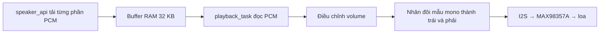

# Đọc dự án loa từ đầu

## Trước hết: ESP32 làm gì?

ESP32 không tự biến chữ thành tiếng. Máy chủ gọi dịch vụ TTS để tạo âm thanh, còn ESP32 chỉ tải và phát âm thanh đó. Hai phần mã chạy ở hai nơi khác nhau:

```text
backend/  → chạy Python trên máy tính/máy chủ
main/     → biên dịch bằng ESP-IDF, sau đó nạp lên ESP32
```

Ví dụ: bạn muốn loa nói **“Xin chào”**. Ứng dụng gửi câu này cho backend. Backend tạo audio, lưu vào cache và xếp một job. ESP32 hỏi backend, nhận job đó, tải audio và phát ra loa. Phát xong, ESP32 gửi kết quả về backend.

## 1. Đọc app_main.cpp trước

ESP-IDF gọi `app_main()` khi ESP32 bật nguồn. File được chia thành hai phần.

**Chuẩn bị — chạy một lần:**

```text
initialize_storage()           Chuẩn bị vùng lưu WiFi trên flash
speaker_api_init()             Kiểm tra URL/token thiết bị
speaker_audio_init()           Chuẩn bị buffer và I2S
speaker_network_init()         Bắt đầu kết nối hoặc nhập WiFi
speaker_network_wait()         Đợi có mạng và địa chỉ IP
speaker_network_sync_clock()   Lấy giờ nếu cần HTTPS
speaker_update_confirm_boot()  Xác nhận boot OTA qua self-test tối thiểu
speaker_update_check()         Kiểm tra bản cập nhật nếu có URL
```

**Vòng lặp — chạy liên tục:**

```cpp
SpeakerJob job;
if (speaker_api_next_job(job)) {
    const bool played = speaker_api_play_job(job);
    speaker_api_report_result(job, played);
}
```

`job` là một biến chứa thông tin câu cần phát. `next_job` trả `true` nếu có câu mới hợp lệ. `play_job` tải và phát câu đó, trả `true` nếu hoàn tất. `report_result` gửi kết quả, không tạo câu mới. Sau mỗi lượt, chương trình nghỉ theo `poll_interval_ms` rồi hỏi tiếp.

## 2. Cấu hình ở đâu?

Đọc `main/speaker_config.h` để nhìn toàn bộ cấu hình. File chia nhóm theo backend, WiFi, dây I2S, định dạng PCM, buffer, thời gian chờ, tác vụ phát và OTA.

| Loại | Đổi ở đâu | Ví dụ |
|---|---|---|
| Thông tin riêng từng board | Sửa trực tiếp các hằng số trong `main/speaker_config.h` | SSID, mật khẩu, URL backend, token, GPIO |
| Thông số xử lý của chương trình | Các hằng số trong `speaker_config.h` | 32 KB buffer, 12 KB prebuffer, thời gian retry |
| Thông tin nhà cung cấp TTS | Biến môi trường của backend, xem `backend/.env.example` | URL TTS, khóa API, giọng đọc |
| Bố trí flash | `partitions.csv` | Vùng NVS, 2 vùng firmware OTA |
| Thiết lập ESP-IDF ban đầu | `sdkconfig.defaults` | Flash 4 MB, stack tác vụ chính |

`speaker_config::wifi_ssid` lấy trực tiếp chuỗi mà bạn nhập trong `speaker_config.h`. WiFi/server/audio/OTA không đọc các giá trị `CONFIG_SPEAKER_*` cũ nữa; menu tùy chỉnh và `Kconfig.projbuild` của loa đã được bỏ.

Quy trình: sửa `speaker_config.h` → lưu → build → nạp lại. `sdkconfig.defaults` và `sdkconfig.h` vẫn phục vụ cấu hình nền tảng ESP-IDF (chip, flash, console), không dùng để nhập WiFi/server của loa.

## 3. API: file speaker_api.cpp

Bạn chỉ cần hiểu bốn hàm công khai trong `speaker_api.h`:

| Hàm | Công việc |
|---|---|
| `speaker_api_init()` | Kiểm tra cấu hình, chuẩn bị header xác thực |
| `speaker_api_next_job(job)` | Hỏi `/next`, đọc JSON và điền vào struct `SpeakerJob` |
| `speaker_api_play_job(job)` | Tải `/audio`, đưa từng phần vào module audio |
| `speaker_api_report_result(job, played)` | Gửi `/ack`, thử lại khi lỗi kết nối |

Các hàm `static` trong file là việc phụ nội bộ: mở HTTP, kiểm tra ID, đọc JSON và gửi một ACK. `app_main` không cần gọi chúng trực tiếp.

Job mẫu:

```json
{
    "id": "ma_cau",
    "lease": "ma_quyen_xu_ly_tam_thoi",
    "volume": 70,
    "audio_bytes": 48000,
    "sample_rate": 24000
}
```

48.000 byte tương ứng một giây PCM16 mono 24 kHz. `lease` giúp backend biết thiết bị đang xử lý đúng lượt đã giao. HTTP `204` nghĩa là chưa có câu, không phải lỗi.

## 4. Âm thanh: file speaker_audio.cpp

Không tải nguyên câu vào RAM. Hai tác vụ trao đổi qua một buffer:



`speaker_audio_begin()` xóa trạng thái câu trước. `speaker_audio_push()` ghi dữ liệu mới vào buffer. Đủ 12 KB thì yêu cầu tác vụ phát bắt đầu. `speaker_audio_end()` báo đã tải xong và chờ phát nốt. Câu ngắn dưới 12 KB sẽ bắt đầu phát lúc tải xong.

PCM16 là mẫu âm thanh có dấu, mỗi mẫu 2 byte. Nửa dương và nửa âm đều phải được giảm đúng khi đổi volume. Hàm `scale_pcm_sample()` xử lý việc này. HTTP có thể chia một mẫu thành hai phần; code giữ byte đầu lại để ghép với byte tiếp theo.

Các cờ `PLAY_REQUESTED`, `DOWNLOAD_FINISHED`, `PLAYBACK_FINISHED`, `PLAYBACK_FAILED` là thông báo giữa hai tác vụ, không phải bốn câu âm thanh khác nhau.

## 5. WiFi và OTA có thể đọc sau

`speaker_network.cpp` chọn một trong ba cách: SSID trong cấu hình, WiFi đã lưu hoặc nhập bằng ESP SoftAP Prov. Hàm `on_network_event()` được ESP-IDF gọi khi trạng thái mạng thay đổi; mất mạng thì xóa cờ kết nối và thử nối lại. `speaker_network_wait()` chỉ tiếp tục khi đã có IP.

`speaker_update.cpp` quản lý OTA. Để URL trống thì bỏ qua tải bản cập nhật. Self-test hiện xác nhận driver âm thanh và WiFi khởi tạo được; chưa xác nhận loa thực sự phát tiếng.

## 6. Backend đọc ở đâu?

`backend/app.py` là API điều phối, SQLite, xác thực và hàng đợi. `backend/tts.py` gọi nhà cung cấp tạo giọng nói và chuẩn hóa audio. Dashboard ở `backend/static/`, còn API lưu cấu hình/nghe thử/đăng ký loa ở `backend/dashboard.py`.

Bạn có thể chạy `scripts/dashboard.ps1` rồi nhập URL, khóa và mẫu JSON TTS trên web. Chỉ sửa `synthesize()` trong `tts.py` nếu nhà cung cấp có hợp đồng khác, ví dụ trả JSON chứa URL âm thanh. Xem `backend/README.md` và `docs/DASHBOARD.md`.

## Từ vựng thường gặp

| Từ | Ý nghĩa trong dự án |
|---|---|
| Firmware | Chương trình nạp lên ESP32 |
| Backend | Chương trình máy chủ Python |
| TTS | Biến văn bản thành tiếng nói |
| Job | Một lượt âm thanh cần phát |
| Polling | ESP32 hỏi định kỳ xem có câu mới không |
| ACK | Thông báo kết quả xử lý |
| PCM | Dãy mẫu âm thanh chưa nén |
| I2S | Giao tiếp âm thanh số giữa ESP32 và MAX98357A |
| Buffer / prebuffer | RAM tạm / lượng tải trước khi bắt đầu phát |
| Task | Tác vụ chạy song song do FreeRTOS quản lý |
| NVS | Vùng flash lưu cấu hình sau mất nguồn |
| PoP | Mã chứng minh quyền nhập WiFi cho thiết bị |
| OTA | Cập nhật firmware qua mạng |
| `constexpr` | Hằng số xác định khi biên dịch |
| `static` trước hàm | Hàm chỉ dùng bên trong file `.cpp` đó |
| `&job` | Tham chiếu: hàm điền/sử dụng chính biến job được truyền vào |

Khi sửa, bắt đầu bằng một nhóm cấu hình hoặc một chức năng ở bảng trong README, build lại, rồi kiểm tra trên board. Các bước kiểm tra thật nằm trong `TEST_CHECKLIST.md`.
