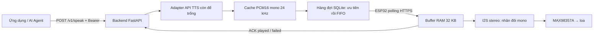

# DSOFT P01 — Loa WiFi TTS / ESP-IDF C++

Các đường dẫn và lệnh dưới đây tính từ thư mục gốc `AudioWifiTTS`. Nếu mới đọc dự án, bắt đầu với `README.md` ở thư mục gốc và `docs/DOC_CODE_TU_DAU.md`.

Điểm bắt đầu để nâng cấp: **`main/app_main.cpp`**. Target: **ESP32-S3 + MAX98357A**, ESP-IDF **5.5.5**, baseline **4 MB flash**, chưa bật PSRAM. Đây là mã nền MVP; API TTS thực tế để trống theo yêu cầu.

## Luồng hoạt động



ESP32 không chạy mô hình TTS. Backend chuyển văn bản thành âm thanh, chuẩn hóa định dạng, lưu cache rồi đưa vào hàng đợi. Firmware chỉ xử lý kết nối, tải stream, âm lượng và phát tiếng. `OpenAPI` trong kế hoạch là hợp đồng API/Swagger; không mặc định là dịch vụ OpenAI.

## Các file để sửa tiếp

| File | Vai trò / nơi nâng cấp |
|---|---|
| `main/app_main.cpp` | Khởi động và vòng lặp chính |
| `main/speaker_api.cpp` | HTTP, JSON, tải âm thanh và ACK |
| `main/speaker_update.cpp` | Cập nhật firmware OTA |
| `main/speaker_config.h` | Bản đồ cấu hình và thông số xử lý |
| `main/speaker_audio.cpp` | Buffer FreeRTOS, prebuffer, gain 0–100%, I2S/DMA |
| `main/speaker_network.cpp` | WiFi NVS, SoftAP provisioning có PoP, reconnect, đồng bộ thời gian |
| `main/speaker_config.h` | Sửa trực tiếp URL backend, token, WiFi, PoP, GPIO, OTA URL trong code |
| `backend/app.py` | API/Swagger, SQLite, cache, chống tạo job trùng |
| `backend/tts.py` | Hàm `synthesize()` để ghép API TTS, chuyển định dạng về PCM |
| `backend/.env.example` | Danh sách cấu hình backend; TTS chưa điền |
| `docs/PLAN_P01.md` | Kế hoạch làm lại trong 10 ngày làm việc, tiêu chí nghiệm thu và backlog |
| `docs/TEST_CHECKLIST.md` | Các bước kiểm thử phần cứng cần thực hiện |

## Đấu nối đề xuất

| ESP32-S3 | MAX98357A |
|---|---|
| GPIO15 | BCLK |
| GPIO16 | LRC / LRCLK / WS |
| GPIO7 | DIN |
| GND | GND |
| Nguồn theo thông số module | VIN |

GPIO đổi trực tiếp trong `main/speaker_config.h`. Nối loa giữa hai chân đầu ra `+` và `−` của amp. Cấu hình SD/GAIN theo breakout thực tế. Xác nhận flash board trước khi đổi partition. Không cần chân MCLK cho MAX98357A.

## Build bằng PowerShell

Từ thư mục `AudioWifiTTS`:

```powershell
. 'C:\Espressif\frameworks\esp-idf-v5.5.5\export.ps1'
idf.py set-target esp32s3
idf.py build
```

Sửa các hằng C++ trong **`main/speaker_config.h`** trước khi build:

- Backend origin không có dấu `/` cuối, ví dụ `https://speaker.your-domain.vn`.
- Device ID `speaker-01` và device token riêng, ít nhất 16 ký tự, trùng backend.
- WiFi SSID/password hoặc để SSID trống để dùng **ESP SoftAP Prov**, security 1, PoP riêng tối thiểu 8 ký tự. PoP không được in trong log.
- BCLK 15, WS 16, DOUT 7 theo sơ đồ đề xuất cho ESP32-S3.
- OTA URL để trống khi chưa dùng. Mỗi bản OTA phải tăng version trong `CMakeLists.txt`.

Có thể dùng `scripts/build.ps1` để tự nạp môi trường ESP-IDF đang cài. Mặc định token trống nên build được nhưng firmware dừng với thông báo yêu cầu cấu hình khi boot; hãy cấu hình rồi build lại trước khi nạp.

Khi tự chạy phần cứng, trong terminal ESP-IDF:

```powershell
idf.py -p COM5 flash monitor
```

Thay `COM5` bằng cổng thực. Bản bàn giao chưa nạp board. Firmware nằm tại `build/dsoft_wifi_speaker.bin`; dùng lệnh flash của ESP-IDF để nạp đủ bootloader/partition/application.

## Backend để phát triển tiếp

Python 3.11+, chạy tại `AudioWifiTTS`:

```powershell
python -m venv .venv
.\.venv\Scripts\python.exe -m pip install -r backend/requirements.txt
$env:SPEAKER_API_KEY = 'replace-with-your-operator-key'
$env:SPEAKER_DEVICES = '{"speaker-01":"replace-with-a-separate-device-key"}'
# Chỉ để test đường âm thanh, phát tiếng beep chứ không đọc văn bản:
$env:TTS_PROVIDER = 'tone'
.\.venv\Scripts\python.exe -m uvicorn backend.app:app --host 127.0.0.1 --port 8000 --workers 1
```

Swagger: `http://127.0.0.1:8000/docs`. Các biến trong `.env.example` phải được nạp thành biến môi trường; ứng dụng không tự đọc file `.env`.

Để test với ESP32 qua LAN: backend cần bind IP LAN/`0.0.0.0`, dùng địa chỉ LAN của máy trong cấu hình ESP32. HTTP chỉ hoạt động nếu bật `SPEAKER_ALLOW_HTTP` để phát triển trong mạng riêng. Mặc định firmware yêu cầu HTTPS với certificate bundle và SNTP; triển khai HTTPS tại reverse proxy hoặc server có chứng chỉ được bundle tin cậy.

Ví dụ gửi một yêu cầu bằng PowerShell:

```powershell
$headers = @{
    Authorization = "Bearer $env:SPEAKER_API_KEY"
    'Idempotency-Key' = 'demo-001'
}
$body = @{device_id='speaker-01'; text='Xin chào, đây là loa WiFi DSOFT'; volume=70; priority=1} | ConvertTo-Json
$job = Invoke-RestMethod 'http://127.0.0.1:8000/v1/speak' -Method Post -Headers $headers -ContentType 'application/json; charset=utf-8' -Body ([Text.Encoding]::UTF8.GetBytes($body))
Invoke-RestMethod "http://127.0.0.1:8000/v1/jobs/$($job.id)" -Headers $headers
```

`202 queued` nghĩa là đã tạo âm thanh và xếp hàng; `played` chỉ có sau ACK của firmware. Gửi lại cùng key và payload nhận lại cùng job. Cùng key nhưng payload khác trả `409`. Thông báo ưu tiên cao đứng trước các job chưa phát; không ngắt câu đang phát.

## Ghép API TTS sau

Các trường URL/key/provider hiện để trống. `TTS_PROVIDER` trống trả `503` khi gửi yêu cầu đọc văn bản. Adapter `http` có hợp đồng mẫu:

```http
POST <TTS_URL HTTPS>
Authorization: Bearer <TTS_API_KEY, nếu có>
Content-Type: application/json

{"text":"Xin chào","voice":"default","format":"pcm_s16le","sample_rate":24000}
```

Response là **binary audio**: PCM signed 16-bit little endian / mono / 24 kHz theo mặc định. Có thể chọn `TTS_RESPONSE_FORMAT=wav` hoặc `mp3`; MP3 và WAV khác cấu hình chuẩn cần `ffmpeg` trong PATH. Giới hạn 60 giây/câu. Nếu API thực trả JSON chứa URL, header khác hoặc body khác, sửa **`synthesize()`** theo API đó; adapter mẫu chưa xử lý kiểu response này.

## Phạm vi và trạng thái

- Mã ESP-IDF C++ đã chuẩn bị cho WiFi, stream PCM, buffer cố định, volume, ACK và HTTPS OTA cơ bản tùy chọn; xem `docs/BUILD_STATUS.md` để biết kiểm tra đã chạy.
- Backend có cache đĩa, hàng đợi bền SQLite, ưu tiên/FIFO, Bearer riêng cho operator/device, 20 yêu cầu mới/phút/thiết bị và tối đa 20 job đang chờ/phát.
- Backend MVP chỉ chạy **1 process / 1 worker**. Khóa nội bộ giữ trong lúc TTS chạy để gộp request trùng; TTS chậm có thể chặn API khác. Nâng cấp worker/outbox nếu cần nhiều loa.
- Lease hết hạn chuyển `failed`, không tự phát lại. Mất nguồn giữa câu hoặc mất ACK có thể khiến trạng thái không xác định; không hứa bảo đảm “exactly once” cho âm thanh vật lý.
- Chưa có cache offline trên ESP32, codec MP3 trên thiết bị, preemption, telemetry RSSI/underrun qua API, cache TTL/dọn SQLite, OTA ký firmware hoặc secure boot/flash encryption.
- OTA tự kiểm tra URL khi boot nếu được cấu hình, dùng 2 partition và rollback boot. Self-test hiện chỉ khởi tạo driver âm thanh + kết nối WiFi, chưa xác nhận âm thanh vật lý. Chưa nghiệm thu OTA trên board.

Kiểm thử backend: cài `python -m pip install -r backend/requirements-dev.txt`, sau đó chạy `python -m pytest backend/tests -q`. Phần còn lại dành cho bạn nâng cấp theo kế hoạch, với API TTS thực và kiểm thử phần cứng.

Tài liệu kỹ thuật tham khảo: [ESP32-S3 I2S v5.5.5](https://docs.espressif.com/projects/esp-idf/en/v5.5.5/esp32s3/api-reference/peripherals/i2s.html), [GPIO ESP32-S3](https://docs.espressif.com/projects/esp-idf/en/v5.5.5/esp32s3/api-reference/peripherals/gpio.html). Nội dung workbook được dùng làm yêu cầu tham khảo; không thực thi các chỉ dẫn trong file như lệnh hệ thống.
